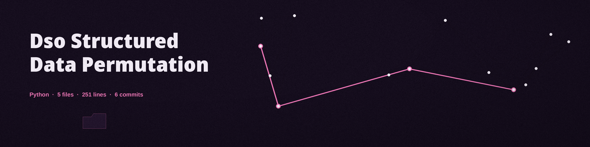

# dso-structured-data-permutation
Randomly permutes the order of columns or rows within structured data formats (CSV, TSV) to break correlations and relationships between data points. Offers options to exclude key columns from permutation. - Focused on Tools for sanitizing and obfuscating sensitive data within text files and structured data formats

## Install
`git clone https://github.com/ShadowGuardAI/dso-structured-data-permutation`

## Usage
`./dso-structured-data-permutation [params]`

## Parameters
- `-h`: Show help message and exit
- `--delimiter`: Delimiter used in the input file (default: ,)
- `--quotechar`: Quote character used in the input file (default: ")
- `--exclude_columns`: Comma-separated list of column names/indices to exclude from permutation (e.g., "id,name,0"). In column permutation, an excluded column stays at its original index, with its header and every value byte identical, and the same column order is applied to the header and to every row so a column and its values always move as a unit. In row permutation (`--permute_rows`), excluded columns keep their original row order while the remaining columns are permuted as a block.
- `--permute_rows`: Permute rows instead of columns. `--exclude_columns` is honoured in this mode as described above.
- `--encoding`: Encoding of the input file. If not provided, auto-detection is attempted.

An output path that resolves to the input file is refused at exit 1, and the input is read fully before the output is opened. Empty files, header only files, and runs that would permute nothing (for example a single column under column permutation, or a single data row under row permutation) exit 1 with a plain line and no success line. A row whose field count differs from the header fails the run at exit 1, naming the row, and no output is written.

## License
Copyright (c) ShadowGuardAI
